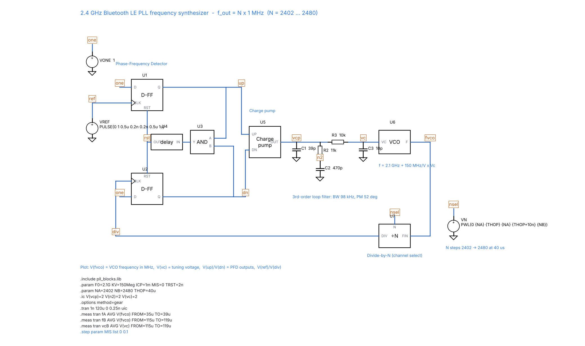
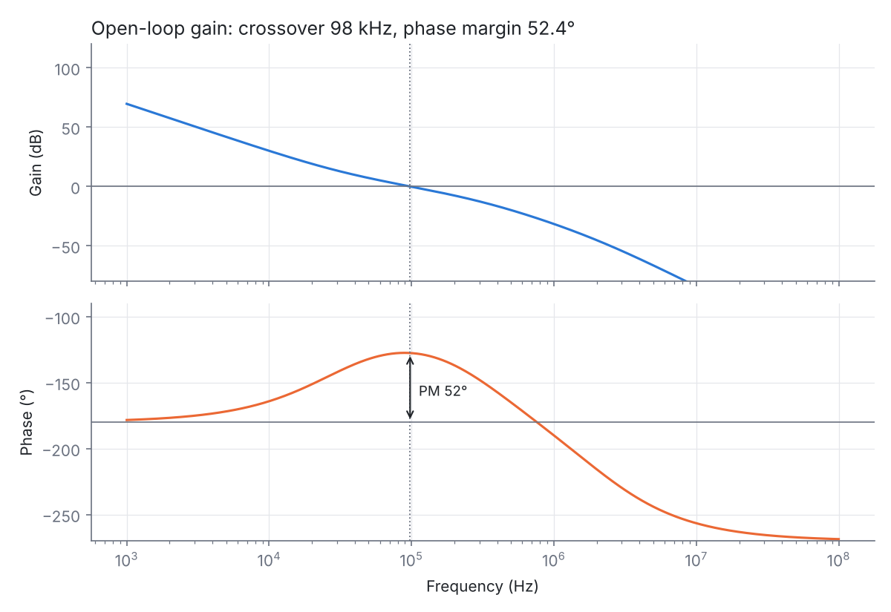
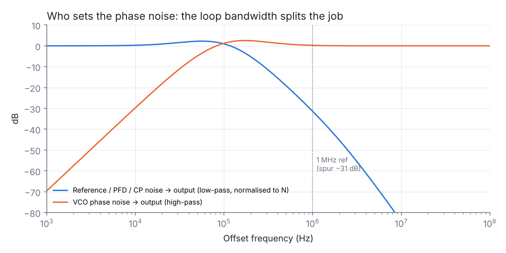
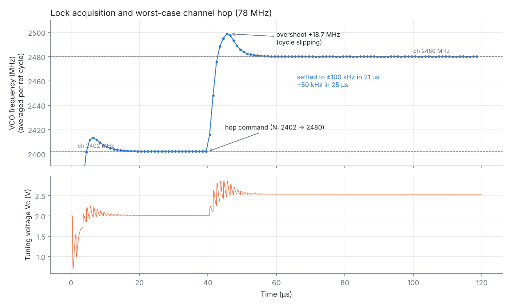
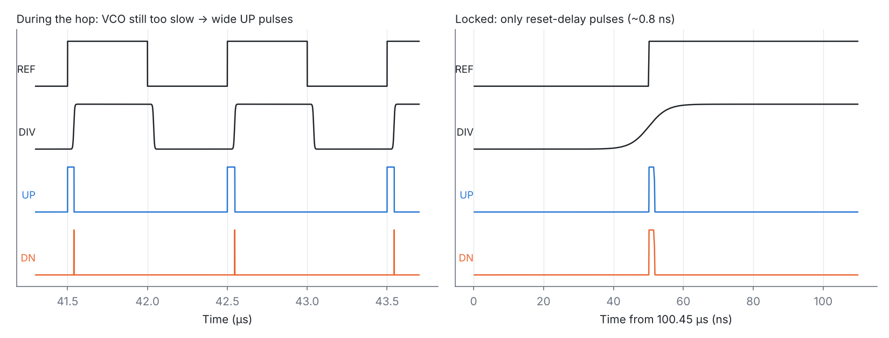
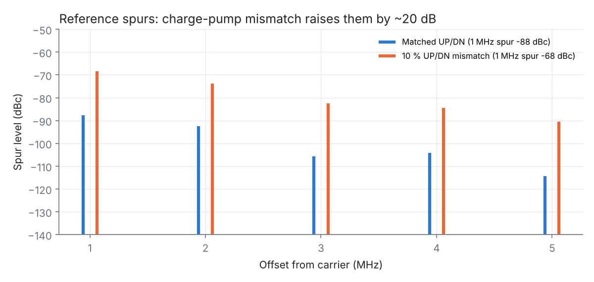

# 2.4 GHz Bluetooth LE Frequency Synthesizer: Charge-Pump PLL in LTspice



**One line for your resume:**
*Designed and simulated an integer-N charge-pump PLL frequency synthesizer for the 2.4 GHz Bluetooth band (2402–2480 MHz, 1 MHz reference). I derived the 3rd-order loop filter from specs (98 kHz bandwidth, 52° phase margin), verified stability with a phase-domain AC model, and verified lock, a worst-case 78 MHz channel hop (settles to ±50 kHz in 25 µs) and reference spurs (−88 dBc, degrading to −68 dBc with 10 % charge-pump mismatch) with a behavioral PFD/CP/VCO/divider transient model.*

---

## 1. The real-world problem

Every Bluetooth, Wi-Fi and cellular radio needs a **local oscillator (LO)** that:

| Requirement | Value used here | Why |
|---|---|---|
| Output frequency | 2402–2480 MHz (40 BLE channels, 2 MHz apart; 79 Classic BT channels, 1 MHz apart) | The RF carrier |
| Accuracy | Locked to a crystal (±20 ppm) | A free-running VCO drifts by MHz with temperature |
| Channel switching | Fast. BLE hops channel on every connection event | Must settle well inside the 150 µs inter-frame gap |
| Spectral purity | Reference spurs < −60 dBc, low phase noise | Spurs mix adjacent channels into your receiver (reciprocal mixing) |

A crystal can't tune and a VCO can't stay accurate. A **phase-locked loop** combines the two: it locks a tunable 2.4 GHz VCO to a stable 1 MHz crystal, and changing the divider N changes the channel.

f_out = N × f_ref = N × 1 MHz, with N = 2402 … 2480

## 2. Architecture

```
            ┌─────┐  UP  ┌──────┐ Icp  ┌──────────────────┐  Vc  ┌─────────────┐
 1 MHz ref ─►     ├─────►│Charge├─────►│ Loop filter      ├─────►│ VCO         ├──┬──► 2.4 GHz LO
 (crystal)  │ PFD │  DN  │ pump │      │ C1‖(R2+C2), R3C3 │      │ 2.1G+150M·Vc│  │
       ┌───►│     ├─────►│ 1 mA │      └──────────────────┘      └─────────────┘  │
       │    └─────┘      └──────┘                                                 │
       │                                    ┌────────────┐                        │
       └────────────────────────────────────┤  ÷ N       │◄───────────────────────┘
               f_div = f_vco / N (1 MHz)     │ 2402..2480 │  ← channel select
                                            └────────────┘
```

| Block | What it does | Model in the simulation |
|---|---|---|
| **PFD** (phase-frequency detector) | Two flip-flops + AND reset. UP if ref leads, DN if div leads. Also detects *frequency* error, so it always pulls into lock | Behavioral latches with edge detectors and a 2 ns **reset delay** |
| **Charge pump** | Turns UP/DN pulse width into a charge packet (±1 mA) | B-source with output compliance 0.1–3.2 V, plus a mismatch parameter |
| **Loop filter** | Integrates charge into the tuning voltage, sets bandwidth and stability, filters ref ripple | Real R/C components |
| **VCO** | f = 2.1 GHz + 150 MHz/V × Vc | Phase-domain: frequency set by Vc, tuning range 0.2–3.1 V |
| **÷N divider** | Brings 2.4 GHz down to 1 MHz for comparison | Phase-domain: divider phase integrates f_vco/N, so edges are exact. No need to simulate a 2.4 GHz waveform, which keeps run time to seconds |

## 3. Loop design (`design/pll_design.py`)

**Choices and why:**
- **Loop bandwidth f_c = 100 kHz = f_ref/10.** A rule of thumb: much above f_ref/10 the sampled PFD makes the loop unstable and the ref spurs grow. A wider bandwidth gives faster settling and suppresses more VCO noise.
- **Phase margin 55°.** About 15 % overshoot, a good balance between speed and ringing.
- **Charge pump 1 mA, K_VCO = 150 MHz/V.** These are typical for an integrated BLE radio.
- **Design at mid-band, N = 2441.** Loop gain ∝ 1/N, so it changes by only ±1.6 % across the band.

**Equations** (type-II loop, 3rd-order filter):

```
Kφ = Icp/2π = 159 µA/rad          Kvco = 2π·150 MHz/V
Open loop  G(s) = Kφ · Z(s) · Kvco / (s · N)
Z(s) ≈ (1 + sT2) / [ s·Ctot·(1 + sT1)(1 + sT3) ]     T2 = R2·C2,  T1 = R2·C1·C2/Ctot,  T3 = R3·C3
Phase peak at ωc:   ωc = 1/√(T2·(T1+T3))
PM = atan(ωc·T2) − atan(ωc·T1) − atan(ωc·T3)          → solve for T1 (bisection)
Ctot = (Kφ·Kvco)/(N·ωc²) · √(1+(ωcT2)²) / [√(1+(ωcT1)²)·√(1+(ωcT3)²)]   (|G(jωc)| = 1)
C1 = Ctot·T1/T2,  C2 = Ctot − C1,  R2 = T2/C2,  R3 = T3/C3
```

**Result** (rounded to standard E-series values):

| C1 | R2 | C2 | R3 | C3 |
|---|---|---|---|---|
| 39 pF | 11 kΩ | 470 pF | 10 kΩ | 10 pF |

Exact check including the R3/C3 loading: **BW = 97.5 kHz, PM = 52.5°**. The 3rd pole costs about 2.5° of the 55° target.

- **Why R2 (the zero)?** Without it, the two integrators (the charge pump into a capacitor, and the VCO) give 180° phase shift and the loop oscillates. The zero restores phase margin.
- **Why C1?** It smooths the step that each current pulse causes across R2 (ref ripple).
- **Why R3/C3?** An extra pole at 1.6 MHz for more reference-spur filtering.

## 4. Results

### 4.1 Stability: phase-domain AC model (`netlists/pll_loop_ac.cir`)

| Parameter | Result |
|---|---|
| Crossover (loop bandwidth) | **97.7 kHz** |
| Phase margin | **52.4°** (matches the design script) |
| Closed-loop −3 dB bandwidth | 166 kHz, with 2.2 dB peaking |
| Ref-path attenuation at 1 MHz | −31 dB |




**Noise transfer.** Reference, PFD and charge-pump noise reach the output **low-pass filtered and multiplied by N** (+67.8 dB, i.e. 20·log N). VCO noise reaches the output **high-pass filtered**. So inside the loop bandwidth the reference path sets the phase noise, and outside it the VCO does. Choosing the bandwidth means balancing these two.

### 4.2 Lock and channel hop: behavioral transient (`ltspice_schematic/pll_synth.asc`)

The VCO starts 2 MHz off frequency and locks to 2402 MHz. At t = 40 µs the divider switches to N = 2480, the **worst-case 78 MHz hop**.

| Event | ±1 MHz | ±100 kHz | ±50 kHz |
|---|---|---|---|
| Initial lock (2400 → 2402 MHz) | 15 µs | 23 µs | 25 µs |
| Channel hop 2402 → 2480 MHz | **14 µs** | **21 µs** | **25 µs** |

Final values: 2480.005 MHz, Vc = 2.533 V (theory: (2480 − 2100)/150 = 2.533 V ✓).



**Why 24 % overshoot when the linear model predicts about 15 %?** A 78 MHz step is far outside the linear range. The phase error exceeds 2π and the PFD **cycle-slips**, working as a frequency detector until the error falls back inside ±2π. This is *nonlinear* acquisition, and the reason real radios use **VCO band pre-selection** (a coarse capacitor bank) before closing the loop.



**Why the reset delay (~0.8 ns pulses when locked)?** If UP and DN were allowed to be arbitrarily narrow, the charge pump couldn't switch fully on for tiny phase errors. That creates a **dead zone**: no correction at all for small errors, which shows up as jitter. Forcing both pulses to a minimum width keeps the PFD + CP gain linear around zero.

### 4.3 Reference spurs and charge-pump mismatch

| UP/DN current mismatch | 1 MHz spur | 2 MHz spur |
|---|---|---|
| 0 % (ideal) | **−88 dBc** | −92 dBc |
| 10 % (`MIS=0.1`) | **−68 dBc** | −74 dBc |



**Mechanism.** With a mismatch, the loop settles at a **static phase offset** so that the net charge per cycle is zero. But UP and DN now dump *different-shaped* charge packets every 1 µs, giving a 1 MHz ripple on Vc. That ripple FM-modulates the VCO into sidebands at ±1 MHz:

spur (dBc) ≈ 20·log(K_VCO·V_ripple / (2·f_ref))

**Fixes:** a matched charge pump with replica biasing / an op-amp that equalises the UP and DN output voltages, a shorter reset delay, a lower loop bandwidth, or a stronger R3C3 pole.

## 5. Verified in LTspice

The wired schematic `ltspice_schematic/pll_synth.asc` was run in **LTspice 26.1.1 on Windows** ([run log](results/ltspice_run_log.txt)):

| Measurement | LTspice | Expected |
|---|---|---|
| Locked frequency, channel 2402 (`fA`) | **2402.0006 MHz** | 2402 MHz |
| Locked frequency after hop to 2480 (`fB`) | **2479.9973 MHz** | 2480 MHz |
| Tuning voltage on 2480 (`vcB`) | **2.5333 V** | (2480 − 2100)/150 = 2.533 V |
| Simulation time (120 µs, 0.25 ns max step) | 6.4 s | |

The log's *"Node vc is floating"* warning is expected: the tuning node connects only to capacitors and the charge-pump current source (no DC path to ground), exactly as in a real charge-pump loop filter. The run starts from `.ic` values (`uic`), so results are unaffected. Add a 1 GΩ resistor from `vc` to ground to silence it.

## 6. Repository layout

| Path | What it is |
|---|---|
| `ltspice_schematic/pll_synth.asc` | **Main LTspice schematic**: PFD (2 D-FF + AND + reset delay), charge pump, R/C loop filter, VCO, ÷N |
| `ltspice_schematic/*.asy` | Symbols for the PLL blocks |
| `ltspice_schematic/pll_blocks.lib` | Behavioral models behind each symbol |
| `netlists/pll_synth_tran.cir` | Same transient simulation as a text netlist |
| `netlists/pll_loop_ac.cir` | Linear phase-domain model: open-loop Bode, phase margin, noise transfer |
| `design/pll_design.py` | Specs → loop-filter component values, with exact BW/PM check |
| `results/` | Plots, schematic image and LTspice run log |

### How to run

1. Download or clone the repo and keep the `ltspice_schematic` folder together.
2. Double-click `pll_synth.asc` → **Run** (about 10 s).
3. Click the `fvco` wire for the VCO frequency in MHz, `vc` for the tuning voltage, and `up`/`dn` for the PFD pulses. Press **Ctrl+L** for the measured `fA`, `fB` and `vcB`.
4. Try: `.step param MIS list 0 0.1` (charge-pump mismatch → reference spurs), `TRST=0.2n` (dead zone), or another `NB` channel.
5. Netlists: File → Open → *All files* → `netlists/*.cir` → Run.
6. Design script: `python3 design/pll_design.py`.

## 7. Interview questions you should expect (with answers)

1. **Why a PFD instead of an XOR / mixer phase detector?** An XOR only detects phase and has limited pull-in range. A PFD also detects *frequency*, so it always acquires lock. It also gives zero output at zero phase error, which with a charge pump means infinite DC gain (type-II loop) and therefore zero static phase error.
2. **What is a type-II PLL?** It has two integrators in the loop: the charge pump into a capacitor, and the VCO (phase = ∫f). That gives zero steady-state phase error for a frequency step.
3. **Why is the loop bandwidth limited to about f_ref/10?** The PFD is a sampled system (one update per reference cycle). The continuous-time approximation breaks down near f_ref/π, and wider bandwidth also passes more reference ripple (spurs).
4. **How does bandwidth trade off?** Wider gives faster lock and more VCO-noise suppression, but more ref/PFD/CP noise and more spurs. Narrower does the opposite. The optimum is near where the in-band noise (×N) meets the VCO noise.
5. **Why does phase noise get multiplied by N (+20·log N)?** Phase scales with frequency: 1 rad of jitter at 1 MHz is N rad at N MHz. This is why fractional-N is used to get a higher f_ref and a lower N.
6. **What causes reference spurs?** Charge-pump UP/DN mismatch, CP leakage, and the timing of the reset-delay pulses. Each puts a periodic ripple on Vc at f_ref.
7. **What is the dead zone, and how is it fixed?** For tiny phase errors the CP pulses are too short to switch fully on, so there is no correction. The fix is a PFD reset delay so that both UP and DN always pulse for a minimum time.
8. **What is cycle slipping?** For large frequency steps the phase error exceeds 2π and the PFD loses the phase relationship temporarily. Lock time then depends on the slew rate, not the linear bandwidth.
9. **Why is the divider modeled in the phase domain?** Simulating 2.4 GHz edges for 120 µs needs about 10⁷ time steps. Integrating phase gives exact edge timing at a fraction of the cost. This is how PLLs are modeled in industry (Verilog-A / CppSim).
10. **Integer-N vs fractional-N?** Integer-N: channel spacing = f_ref, so a small f_ref and a large N mean more noise and a narrow bandwidth. Fractional-N uses a ΣΔ-modulated N to allow a 26–40 MHz reference with fine frequency steps, at the cost of fractional spurs.

## 8. Extensions (good to mention)

- Fractional-N with a 2nd/3rd-order ΣΔ modulator driving N (26 MHz reference)
- Transistor-level charge pump (current-steering with an op-amp up/down match) to see the real mismatch
- Phase-noise budget: add a VCO noise profile (−110 dBc/Hz at 1 MHz) and integrate RMS jitter
- VCO band switching (capacitor bank) + automatic band calibration before closed-loop lock
- Lock detector (counts UP/DN pulses wider than a threshold)

## 9. Model limitations

- PFD, VCO and divider are behavioral (ideal, noiseless). The output is the frequency/phase, not a 2.4 GHz waveform.
- Small (±15 kHz) per-cycle frequency jitter in the locked transient is numerical (time-step quantization of sub-ns pulses), not physical.
- The VCO is perfectly linear (real K_VCO varies about ±30 % across the tuning range, which changes bandwidth and PM per channel).
